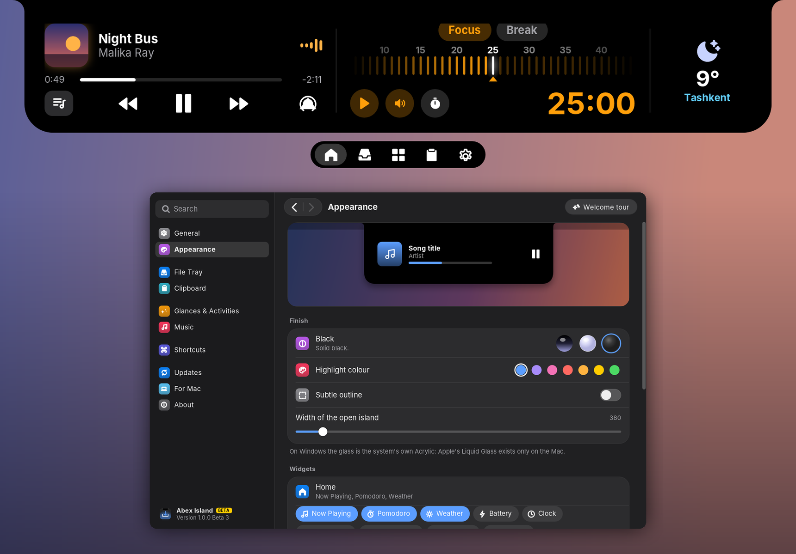

# Abex Island

**Остров вверху экрана для Mac и Windows: файлы, музыка, виджеты и сообщения в одном месте.**

[**Скачать для Mac**](https://github.com/AbexLab/INT_Abex-Island/releases/latest) · [**Скачать для Windows**](https://github.com/AbexLab/INT_Abex-Island/releases/download/v1.0.0-beta.3/Abex-Island-1.0.0-beta.3-Windows.zip)

macOS 14+ · Windows 10 (2004+) и 11 · бесплатно

[English](README.md) · **Русский** · [O‘zbekcha](README.uz.md) · [Қазақша](README.kk.md) · [Türkçe](README.tr.md)

(ﾉ◕ヮ◕)ﾉ*:･ﾟ✧

---

### Что умеет

| | |
|---|---|
| **Файлы** | Бросьте файлы на чёлку, чтобы держать их под рукой, или потрясите курсором во время перетаскивания, и появится плавающая корзина |
| **Музыка** | Apple Music, Spotify и Яндекс Музыка с обложками, прогрессом, текстами песен и управлением, даже когда окно плеера закрыто |
| **Сообщения** | Сообщения Telegram и WhatsApp выплывают из чёлки стеклянными карточками, и ответить можно прямо в них (на Mac) |
| **Люди** | Избранные, живые чаты с галочками и статусом в сети, голосовые, шаблоны и отложенная отправка (на Mac) |
| **Виджеты** | История буфера обмена, таймер фокуса, погода, календарь и не только |
| **Mac и Windows** | На Mac остров живёт в чёлке; на экранах без неё и на Windows он стоит у верхнего края экрана и умеет прятаться в тонкую полоску |

Обновления приходят сами: один клик, и у вас новая версия.

### Установка на Mac

1. Скачайте `.zip` в разделе [Releases](https://github.com/AbexLab/INT_Abex-Island/releases/latest) и откройте его.
2. Перенесите **Abex Island** в папку «Программы» и открывайте оттуда.
3. В первый раз нажмите на приложение с Control и выберите **Открыть** (или Системные настройки → Конфиденциальность и безопасность → **Всё равно открыть**).
4. Приложение само попросит нужные разрешения (Универсальный доступ, Полный доступ к диску для уведомлений о сообщениях) и объяснит каждое.

### Установка на Windows

1. [Скачайте `.zip` для Windows](https://github.com/AbexLab/INT_Abex-Island/releases/download/v1.0.0-beta.3/Abex-Island-1.0.0-beta.3-Windows.zip) и откройте из него **Abex Island.exe**.
2. Windows может сказать, что издатель неизвестен: нажмите **Подробнее → Выполнить в любом случае**.
3. Нажмите **Установить** в окне приветствия: приложение появится в меню «Пуск», будет открываться при входе и обновляться само. Права администратора не нужны.

### Статус

Это **бета**: что-то ещё может сломаться, и каждый отзыв помогает. Нашли ошибку или есть идея? Создайте [issue](https://github.com/AbexLab/INT_Abex-Island/issues).

### Лицензия

Abex Island **бесплатно для использования**, но это не открытый код. © 2026 Abex. Все права защищены.
Приложение нельзя копировать, изменять, декомпилировать, перепродавать или распространять без письменного разрешения Abex. Подробнее в [LICENSE](LICENSE.md) (на английском).

Сделано в Abex
